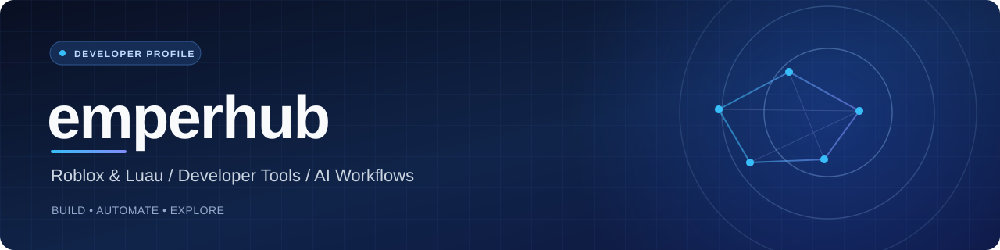

  

  
  
  
  

  Building useful tools for developers, from Roblox interfaces to local AI integrations and Windows automation.

---

### About me

I'm **emperhub**, a developer interested in **Roblox / Luau**, **developer experience**, and **AI-connected workflows**. I enjoy building practical utilities, experimenting with integrations, and documenting how to use them.

My current learning interests include **Python** and **AI research fundamentals**.

### Featured projects

| Project | Overview | Explore |
| :--- | :--- | :--- |
| **PearlUI** | A Luau UI library for Roblox with themes, components, icon support, and documentation. | [Repository](https://github.com/emperhub/PearlUi) · [Documentation](https://emperhub.github.io/PearlUi/) |
| **NovaMCP** | MCP-based tools connecting AI clients to Roblox runtime workflows through a Node.js / WebSocket bridge. | [Repository](https://github.com/emperhub/NovaMCP) |
| **Serena Tunnel Starter** | A Windows setup project for connecting ChatGPT, an MCP tunnel, Serena, and a local workspace. | [Repository](https://github.com/emperhub/Serena) |
| **callshelf** | A PowerShell GUI/CLI utility for managing Cloudflare WARP connectivity on Windows. | [Repository](https://github.com/emperhub/callshelf) |

### Tools & technologies

  
  
  
  
  
  

### Areas of interest

- **Roblox development:** reusable Luau modules, interface libraries, and developer tooling.
- **AI integrations:** connecting assistants to useful tools through MCP and local services.
- **Automation:** small utilities that reduce repetitive work and improve workflows.

---

  <b>Explore the projects above or browse <a href="https://github.com/emperhub?tab=repositories">all repositories</a>.</b>

